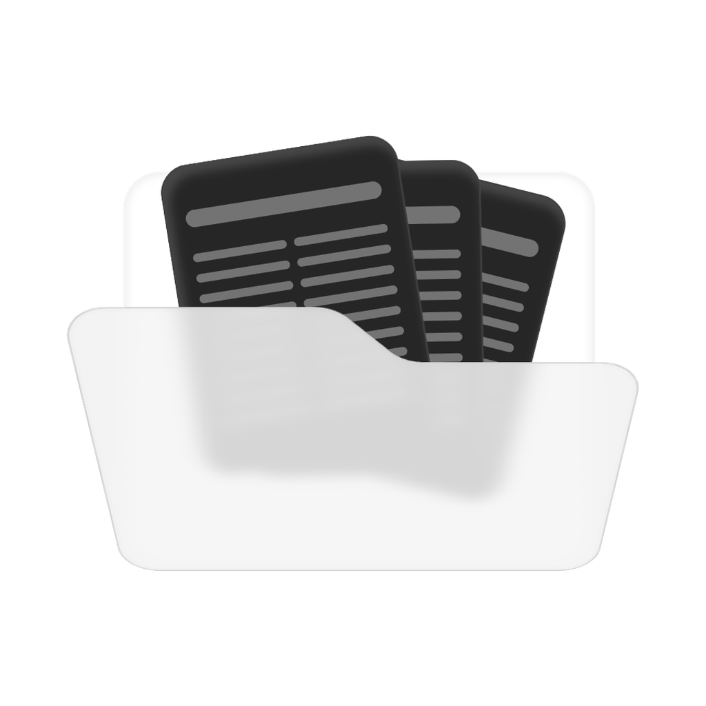

# MyFolds

[中文](README.md) · English

<picture>
  <source media="(prefers-color-scheme: dark)" srcset="resources/IconArtwork/myfolds-dark-1024.png">
  
</picture>

A native macOS file manager built with SwiftUI, AppKit, and system materials for everyday file organization, path navigation, and previews.

Current version: **0.1.13**, in testing. Requires **Apple Silicon and macOS 27.0+**.

## Features

- **File management:** copy, cut, paste, rename, create folders, browse Trash, and review operation history.
- **Paths and tabs:** editable full paths, prefix completion, independent tabs in two panes, bulk tab closing, and file drops onto tabs.
- **Quick Access:** drag files or folders into the sidebar to add shortcuts, with contextual actions.
- **Built-in viewers:** text editing, Markdown editing and preview, images, video, and PDF. Other documents use system Quick Look.
- **Text editor:** line numbers, fonts, sizing, independent appearance, and syntax highlighting. Single-file search and replace supports whole words, regular expressions, selection scope, and a resizable results panel.
- **Open with:** choose a built-in viewer or external application by extension or file category.
- **Disk images and archives:** mount, browse, and eject DMGs inside MyFolds; drag files to the Applications link; browse and extract archives and create ZIP files.
- **Appearance:** light, dark, or system appearance with configurable accent colors. New installations default to graphite.

See the [release notes and supported scope](原生测试版说明.md) (Chinese) for details.

## Build and install

Requires Xcode 27.2 / Swift 6.4. There are no third-party Swift package dependencies. Archive handling uses the system libarchive.

```bash
git clone git@github.com:shenmuoso/MyFolds.git
cd MyFolds

# Run tests
swift test --configuration release

# Build the debug app
bash scripts/build-app.sh debug

# Build the release app and DMG
bash scripts/package-dmg.sh
```

| Artifact | Path |
| --- | --- |
| Debug app | `.build/Preview/MyFolds.app` |
| Release app | `.build/Release.noindex/MyFolds.app` |
| Disk image | `outputs/releases/MyFolds-0.1.13-arm64.dmg` |

Open the generated DMG and drag MyFolds into Applications. The debug app has a separate bundle identifier and preferences, preserving the installed app's settings.

Builds currently use ad-hoc signing and are not Developer ID signed or notarized by Apple. DMGs and local build artifacts are excluded from Git.

## File access

To access protected folders, enable MyFolds in **System Settings → Privacy & Security → Full Disk Access**. MyFolds provides guidance when needed. You can choose not to show the reminder again and restore it under **Preferences → File Access**.

## Project structure

| Directory | Contents |
| --- | --- |
| `Sources/MyFolds/` | SwiftUI views, AppKit bridges, windows, and application state |
| `Sources/MyFoldsCore/` | File operations, archives, text search, and syntax parsing |
| `Tests/` | File, editor, window lifecycle, and navigation regression tests |
| `resources/` | App metadata, icon sources, and third-party notices |
| `scripts/` | Icon generation, app builds, and DMG packaging |
| `outputs/myfolds-design/` | Earlier interactive prototypes with sample data |

## Author and related project

By [shenmuoso](https://github.com/shenmuoso) · [Repository](https://github.com/shenmuoso/MyFolds) · [Issues](https://github.com/shenmuoso/MyFolds/issues)

Also by the author: [mac-scope](https://github.com/shenmuoso/mac-scope), a macOS resource management, monitoring, and system cleanup tool.

## License

[MIT](LICENSE). See [ThirdPartyNotices](resources/ThirdPartyNotices.txt) for the libarchive headers' license.
