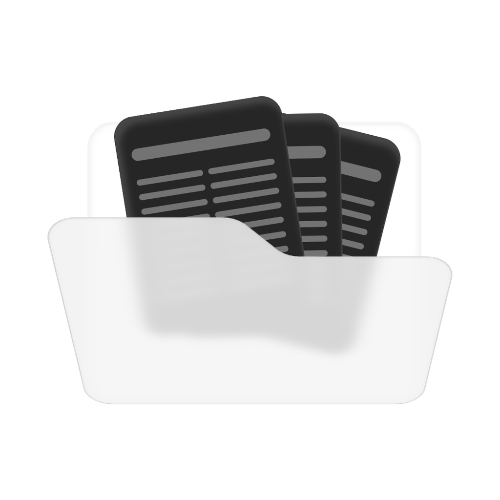

# MyFolds

中文 · [English](README.en.md)

<picture>
  <source media="(prefers-color-scheme: dark)" srcset="resources/IconArtwork/myfolds-dark-1024.png">
  
</picture>

macOS 原生文件管理器，使用 SwiftUI、AppKit 和系统磨砂材质，面向日常文件整理、路径导航和文件预览。

当前版本：**0.1.13**，测试阶段。支持 **Apple Silicon / macOS 27.0+**。

## 功能

- **文件管理**：复制、剪切、粘贴、重命名、新建文件夹、废纸篓及操作记录。
- **路径与标签**：可编辑的完整路径、前缀补全、双栏独立标签页、批量关闭标签、跨标签拖放。
- **快速访问**：拖入文件或文件夹添加快捷入口，支持侧栏右键菜单。
- **内置查看器**：文本编辑、Markdown 编辑与预览、图片、视频和 PDF；其他文档使用系统 Quick Look。
- **文本编辑器**：行号、字体、字号、独立外观、语法高亮；单文件搜索替换支持全词、正则、仅选区和结果列表。
- **打开方式**：按扩展名或文件类别选择内置查看器或外部应用。
- **磁盘映像与压缩包**：在应用内挂载、浏览和弹出 DMG；支持拖入 Applications 链接、压缩包浏览与解压、创建 ZIP。
- **外观**：浅色、深色、跟随系统和可选强调色；首次安装默认石墨色。

支持范围和版本记录见 [原生测试版说明](原生测试版说明.md)。

## 构建与安装

需要 Xcode 27.2 / Swift 6.4。无第三方 Swift 包依赖，压缩处理使用系统 libarchive。

```bash
git clone git@github.com:shenmuoso/MyFolds.git
cd MyFolds

# 测试
swift test --configuration release

# 调试应用
bash scripts/build-app.sh debug

# 发布应用和 DMG
bash scripts/package-dmg.sh
```

| 产物 | 位置 |
| --- | --- |
| 调试应用 | `.build/Preview/MyFolds.app` |
| 发布应用 | `.build/Release.noindex/MyFolds.app` |
| 安装镜像 | `outputs/releases/MyFolds-0.1.13-arm64.dmg` |

打开生成的 DMG，将 MyFolds 拖入 Applications。调试版使用独立的应用标识及偏好设置，不会覆盖安装版设置。

当前构建使用 ad-hoc 签名，尚未进行 Developer ID 签名及 Apple 公证。DMG 和本机构建文件不纳入 Git。

## 文件访问权限

访问受保护目录需要在“系统设置 → 隐私与安全性 → 完全磁盘访问权限”中启用 MyFolds。应用会在需要时提供引导，可勾选“下次不再提醒”；也可在“偏好设置 → 文件访问”恢复提醒。

## 项目结构

| 目录 | 内容 |
| --- | --- |
| `Sources/MyFolds/` | SwiftUI 界面、AppKit 桥接、窗口和应用状态 |
| `Sources/MyFoldsCore/` | 文件系统、压缩处理、文本搜索与语法解析 |
| `Tests/` | 文件操作、编辑器、窗口生命周期和导航回归测试 |
| `resources/` | 应用信息、图标源文件及第三方许可 |
| `scripts/` | 图标生成、应用构建和 DMG 打包 |
| `outputs/myfolds-design/` | 使用示例数据的历史交互原型 |

## 作者与相关项目

作者：[shenmuoso](https://github.com/shenmuoso) · [项目地址](https://github.com/shenmuoso/MyFolds) · [反馈问题](https://github.com/shenmuoso/MyFolds/issues)

推荐作者的另一个项目：[mac-scope](https://github.com/shenmuoso/mac-scope)，用于 macOS 资源管理、监控与系统清理。

## 许可

[MIT](LICENSE)。libarchive 头文件许可见 [ThirdPartyNotices](resources/ThirdPartyNotices.txt)。
