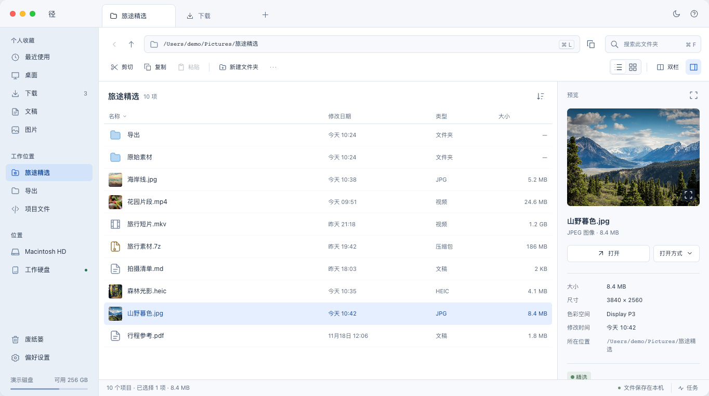
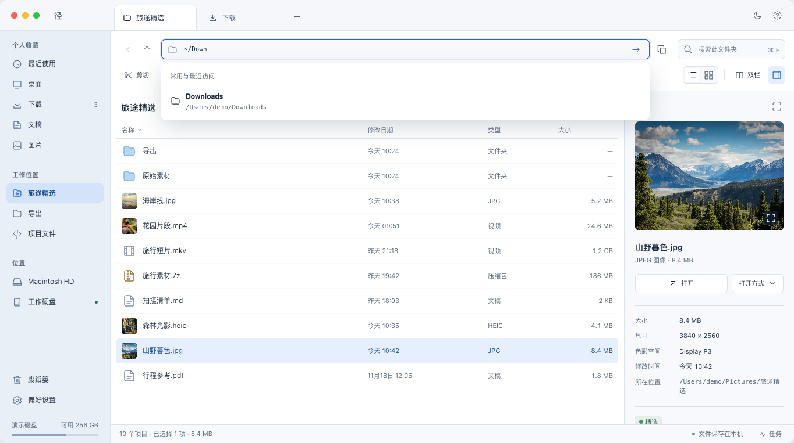
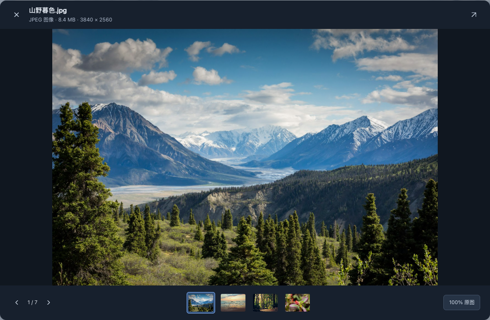
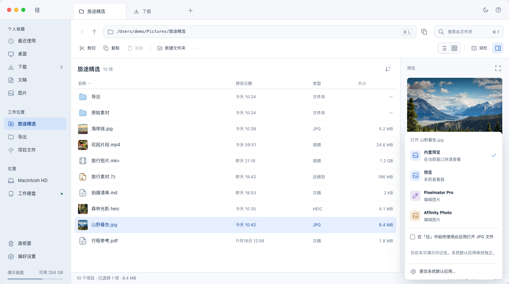
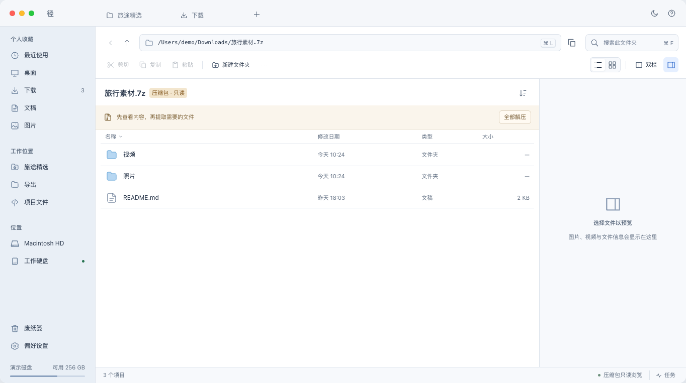
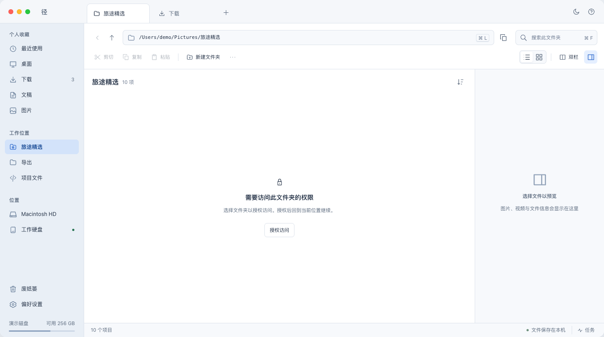
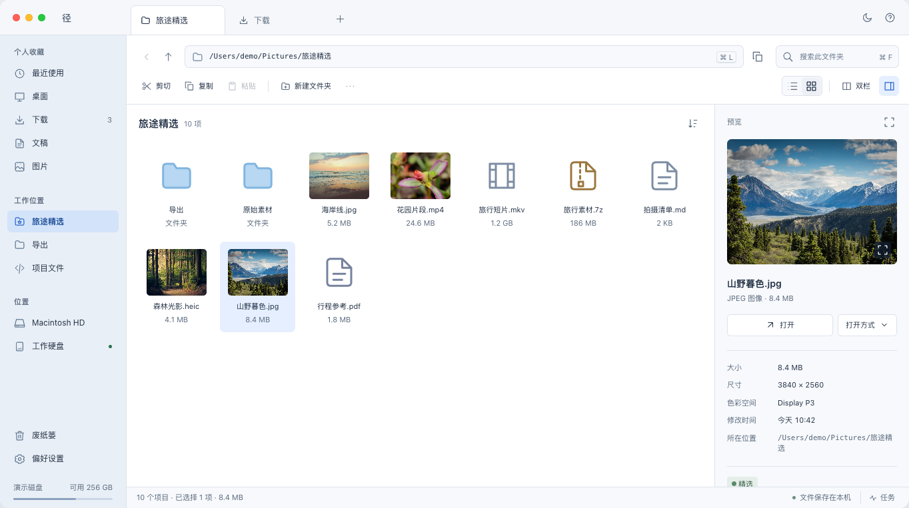
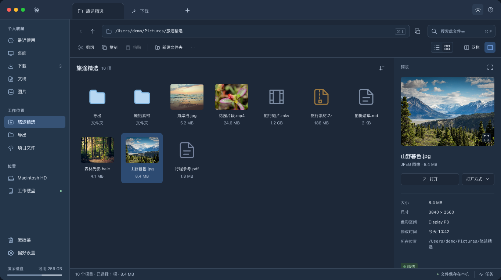

# 径 · macOS 文件管理器设计方案

版本 0.1 · 2026 年 11 月 20 日 · 供评审的设计提案

「径」是工作名称，尚未确定产品品牌。本方案围绕五项已确认需求：复制剪切粘贴、路径操作、多媒体预览、打开方式、多格式压缩包。交付包含 UI 设计、交互规则、异常处理、实现分层与第一版验收标准。

当前为设计与交互演示：文件、路径、容量、元信息、应用列表和任务进度均为示例。原型不读取或修改真实文件，不启动外部应用，不改变系统关联。尚未确定的事项包括最低 macOS 版本、发布方式，以及实际媒体与压缩格式清单。

## 产品定位

为需要频繁整理本地文件的 macOS 用户提供操作直接的文件管理器。路径、来源、目标、选择范围与操作结果始终清楚可见；常用操作同时提供按钮、右键菜单与快捷键。

第一版围绕一条完整工作链：找到位置 → 选中与预览 → 复制或移动 → 处理冲突 → 确认结果。媒体预览、打开应用和压缩包浏览都在这条链中完成。

| 用户问题 | 设计回应 | 完成标准 |
|---|---|---|
| 复制、剪切、粘贴不直观 | 常驻按钮；⌘X/C/V；待移动栏；来源与目标明确 | 在两个目录间完成移动，遇到冲突时能选择策略，取消后看清已处理和未处理的项目 |
| 路径难看、难复制、难跳转 | 顶部完整路径；点击或 ⌘L 编辑；独立复制按钮；补全与历史 | 粘贴目录路径直接进入；粘贴文件路径进入父目录并选中文件 |
| 图片、视频预览不顺畅 | 随选预览、空格放大、连续切换、原图查看、视频进度控制 | 连续筛选一组素材而不反复打开独立应用；不支持的格式有明确出口 |
| 打开应用选择不理想 | 常用应用；本次打开、工具内默认、系统默认分开 | 记住选择时知道作用范围，随时能改回 |
| 压缩格式不足 | 压缩包只读目录；按需提取；读取与创建格式分别声明 | 不先解压全部内容即可查看目录并提取所选项目 |

## 主窗口 UI

默认采用“位置侧栏 + 单文件区 + 预览检查器”。整理文件时可切换双栏；双栏模式默认收起检查器，给文件名称与操作目标留出足够空间。保留标签页入口，用于在常用位置之间切换。

| 区域 | UI 与尺寸建议 | 交互职责 |
|---|---|---|
| 窗口与标签 | 标题栏 53 px；原生窗口控制；目录标签 | 标签各自保留目录、排序、滚动与选择；新标签打开个人目录 |
| 位置侧栏 | 宽屏 190 px，紧凑 155–172 px；生产版可拖动调整 | 个人收藏、工作位置、磁盘；废纸篓和设置固定在下方 |
| 路径导航 | 输入区高 34 px；后退、上一级、完整路径、复制路径 | 始终显示真实当前位置，路径本身支持编辑 |
| 文件操作栏 | 高约 41 px；图标和文字结合 | 剪切、复制、粘贴、新建、更多；视图、双栏与预览切换 |
| 文件区 | 名称优先；43 px 行高，紧凑模式 34 px | 多选、排序、搜索、图标视图；窄窗口依次隐藏日期与类型列 |
| 检查器 | 宽屏 292 px，紧凑 225–252 px；独立滚动 | 预览、元信息、打开方式、文件路径；多选时显示摘要 |
| 操作反馈 | 底部待操作栏与任务栏，按需出现 | 保留来源、目标、数量、进度、取消、结果与可用的撤销 |

原生窗口建议最小 960 × 640 pt；推荐 1200 × 760 pt 及以上。HTML 设计稿的 px 用于演示，不等同于已经验证的 AppKit 布局。窄浏览器提供可审阅的收缩布局，不代表要开发手机版。

界面上的“修改路径”始终表示导航；真实文件和文件夹的名称修改必须走独立重命名流程。地址显示使用从左到右的路径顺序，不能因截断导致斜杠顺序错乱。

## 关键交互

### 路径与导航

点击地址栏或按 ⌘L → 全选完整路径 → 输入、粘贴或选取补全 → Return 前往。Escape 取消编辑，保留原目录。支持绝对路径、以 ~ 开头的用户路径，以及产品中明确处理的 file:// 地址。路径不是命令输入，不执行 shell 字符串。

文件路径进入父目录后选中文件；文件夹路径直接进入。不存在、不是目录、无访问权限分别提示，保留用户输入以便修正。路径复制有普通路径与供终端使用的转义路径两种产品选项；原型实现普通路径复制。列表搜索第一版限定当前文件夹，并直接写明搜索范围。

### 剪切、粘贴与双栏

选择文件 → 剪切 → 源项目变淡并出现剪切标记 → 底部显示“等待移动” → 前往目标目录 → 粘贴 → 冲突处理 → 执行 → 明确结果。

剪切只记录意图，不删除源文件。等待阶段可取消或重新剪切。双栏中的当前操作位置同时由顶部细线和文字标识；全局地址栏和粘贴按钮跟随当前操作栏。两栏各自显示路径，鼠标点击或键盘切换栏后，粘贴目标立即更新。

跨应用应支持标准文件复制和拖放互通；不能假设 Finder 或第三方应用理解本工具内部的“等待剪切”标记。原型只演示工具内的文件操作。

### 同名冲突

同时展示目标文件与即将写入文件的名称、大小、修改时间和可用的缩略图。提供取消、跳过、保留两份和替换。默认推荐保留两份，自动添加编号；替换明确说明将覆盖目标文件。

生产版多项任务先显示“当前冲突项”，由用户主动勾选是否应用到其余冲突，不预先扩大选择范围。原型将策略应用到本次示例任务的所有同名文件，并在对话框中明示。文件夹合并不能复用文件覆盖的简单逻辑，需要单独说明子项冲突。

### 图片与视频预览

单击选中即更新检查器，不启动外部程序；Space 进入快速预览，Escape 或 Space 返回原位置。放大后保留当前文件名、序号、上一项/下一项和缩略条。图像支持适合窗口与原图比例；产品阶段再加入平移、缩放级别与旋转。

视频提供播放暂停、音量、进度拖动、时长与基本编码信息。原型播放本地 CC0 MP4 示例，不能据此声称 HEVC、MKV、HDR、RAW 或所有编码已经受支持。产品必须按“封装 + 编码 + 音轨”验证支持情况，失败时给出“选择播放器”的明确出口。

缩略图按需加载并缓存。切换选中项时撤销过时请求，避免旧预览覆盖新文件；元信息和缩略图工作不得阻塞目录操作。原型中的 HEIC 文件名使用 JPEG 示例图像演示布局，不是 HEIC 解码验证。

### 打开方式

打开方式菜单展示内置预览与常用应用。点击应用默认只影响这一次；主动勾选后才记住“在径中始终使用此应用打开此类文件”。设置中集中查看与重置规则。

双击或“打开”使用当前有效规则；Space 始终保留快速预览语义。工具内类型规则优先于工具的默认建议；系统关联属于独立作用域。选择“更改系统默认应用”进入明确的系统关联流程，不能因为选择一次应用而顺带改变 macOS 全局行为。

原型只保存当前演示会话的工具内偏好；外部应用打开使用提示代替，系统默认入口展示操作说明。没有检测或声称这些应用已安装。

### 压缩包浏览与解压

打开压缩包进入只读虚拟目录；路径和“压缩包 · 只读”标签同时说明当前位置。可浏览子目录、选择项目，再点击“解压所选”；未选择时使用“全部解压”。目标选择中展示实际路径、同名策略和预计空间，执行后提供任务结果与前往目标的入口。

压缩包内的复制导出应明确等同于提取；剪切、重命名与删除禁用，不把虚拟条目误当成已存在的本地文件。第一版不允许直接编辑压缩包内容。

| 格式能力 | 第一版建议范围 | 后续或单独验证 |
|---|---|---|
| 浏览与解压 | ZIP、7z、RAR、TAR 与常用压缩变体 | 各格式版本、加密算法、分卷组合、特殊编码逐项验证 |
| 创建压缩包 | ZIP | 7z 创建、密码强度与兼容性选项 |
| RAR | 读取与解压 | 不把 RAR 创建列为默认承诺 |
| 安全与文件保真 | 提取限制在目标范围；识别覆盖冲突；保留必要元信息 | 符号链接、扩展属性、资源分支、跨文件系统差异 |

这里是支持目标，不是已完成的格式认证。原型展示 7z 的目录、选择与提取流程，但没有实际解析压缩文件。

## 状态与恢复

| 状态 | 用户看到什么 | 下一步 |
|---|---|---|
| 空文件夹 | “此文件夹为空”；仍保留当前完整路径 | 新建文件夹或粘贴 |
| 搜索无结果 | 保留关键词与搜索范围 | 清除搜索或修改关键词 |
| 目录读取中 | 加载说明；可取消；已加载条目渐进呈现 | 等待或取消；失败后保留导航位置 |
| 无访问权限 | 明确是权限问题，不误报文件不存在 | 选择文件夹授权；取消后保持原位置 |
| 外接盘断开 | 文件操作停止；已完成和待处理项目分开 | 重连后重试未完成项，不能一键重复全部成功项 |
| 任务取消 | 明确哪些已完成，哪些未开始，哪些产生临时文件 | 查看结果或清理临时项目 |
| 空间不足 / 只读 / 文件被占用 | 问题、受影响文件与目标位置 | 换目标、释放空间或重试 |
| 预览不支持 / 读取失败 | 文件仍可管理；预览失败单独提示 | 用其他应用打开 |

原型为了清楚演示，在任务完成时统一提交内存变更，所以取消可以保留全部源项目。真实跨磁盘批量操作可能已经部分完成，不能沿用这个简化假设。产品必须记录逐项状态并显示真实结果。

## 文件操作可靠性

操作需要经历：校验来源和目标 → 检测冲突与容量 → 执行 → 确认结果 → 更新列表与历史。复制、移动、解压与删除共用任务中心，但保持各自的提交与恢复规则。

同一文件系统移动优先使用系统提供的移动语义；跨文件系统移动需要先复制并确认目标写入成功，再移除对应源项目。保留未完成任务记录，重新打开应用后显示可恢复或需人工处理的状态。

撤销不是无条件承诺。重命名、移动、新建和移到废纸篓可在条件允许时撤销；覆盖已有目标、来源被其他应用修改或磁盘离线时，必须显示不能完整撤销的原因。原型的内存快照撤销仅用于演示，不等同于生产能力。

## 视觉与交互规范

视觉取向为冷白工作区、灰蓝位置侧栏、深蓝灰正文和蓝色选择状态。以长时间白天桌面操作为默认场景，浅色优先；提供深色外观。图片与视频自身承担主要色彩，不用装饰抢占文件注意力。

| 设计变量 | 当前设计值 | 用途 |
|---|---|---|
| 主工作区 | #FFFFFF | 文件内容 |
| 次级区域 | #F7F9FC | 检查器、状态与次级输入 |
| 侧栏 | #E9EFF6 | 位置与磁盘导航 |
| 正文 | #202E43 | 文件名与主要信息 |
| 次级文字 | #58677B | 元信息、描述 |
| 强调 | #2865CA | 主要按钮、焦点与当前操作位置 |
| 选择底色 | #E5EFFF | 文件选中与局部提示 |
| 分隔线 | #DDE3EB | 区域、表头与输入边界 |
| 成功 / 危险 / 警告 | #277351 / #B63C3C / #916019 | 与文案和图标共同表意 |
| 字体 | macOS 系统字体，路径用系统等宽字体 | 熟悉的原生阅读体验 |
| 字号 | 区域标题 15–17；文件名 12；工具文字 11–12；次级信息 11 | 以文件名可读性为优先；生产版支持密度偏好 |
| 圆角 | 输入与按钮 6–7；浮层 9；应用窗口 14 | 区分控件与容器 |
| 动效 | 预览进入 160 ms；状态即时更新 | 减少动态效果时关闭过渡 |

文件与目录选中不能只靠颜色：焦点、选择状态和计数同时可感知。原生版本采用 VoiceOver 可读标签，工具栏保持可见焦点和合理点击区域。生产验收需独立完成 VoiceOver、键盘焦点、缩放与实际文字对比测试；当前原型没有宣称通过完整无障碍认证。

## 快捷键

| 动作 | 建议按键 | 原型 |
|---|---|---|
| 复制 / 剪切 / 粘贴 | ⌘C / ⌘X / ⌘V | 支持；浏览器可能保留组合键，可用按钮 |
| 编辑路径 / 搜索当前目录 | ⌘L / ⌘F | 支持 |
| 复制所选文件路径 | ⌥⌘C | 支持普通路径 |
| 快速预览 / 关闭 | Space / Escape | 支持 |
| 多选 / 全选 | ⌘点击、Shift 点击 / ⌘A | 支持 |
| 打开 / 上一级 | ⌘↓ / ⌘↑ | 支持 |
| 重命名 / 新建文件夹 | Return / ⇧⌘N | 支持 |
| 移到废纸篓 / 撤销 | ⌘Delete / ⌘Z | 示例操作支持 |
| 切换操作栏 / 标签 | Tab（文件区内）/ 原生标签快捷键 | 产品阶段实现完整焦点与标签会话 |

## 实现分层建议

采用独立原生 macOS 应用。SwiftUI 负责状态与主要界面，必要的系统交互、菜单、窗口与文件能力通过 AppKit 等原生机制接入。最终选型应通过大目录、拖放和预览原型验证，不把 HTML 设计稿当作产品技术栈。

| 模块 | 职责与边界 |
|---|---|
| 浏览会话 | 每个标签 / 栏的路径、选择、历史、排序和滚动状态 |
| 文件来源 | 区分真实文件系统与压缩包虚拟目录，向 UI 提供统一展示模型 |
| 操作协调器 | 计划、冲突策略、执行队列、进度、取消、结果和有条件撤销 |
| 预览管线 | 类型识别、缩略图、元信息、图片解码、视频播放、过时请求取消 |
| 打开方式路由 | 本次选择、工具内类型规则、系统关联入口 |
| 压缩服务 | 列目录、提取、创建；格式与能力矩阵；错误分类 |
| 权限与偏好 | 用户授权位置、书签、常用位置、主题与密度；对持久授权进行实际验证 |

不把替换系统桌面、所有应用的打开 / 保存对话框或 Finder 的全部职责列为第一版目标。发布为独立下载版还是 App Store 版，会影响沙盒、权限、签名与分发方案，应在产品实现前确定。

## 第一版与验收

第一阶段先验证目录浏览、路径输入与可靠操作；第二阶段完成媒体预览和打开方式；第三阶段接入压缩服务并完成边界状态。第一版发布门槛是五个需求均有完整可用路径，不能只凭静态界面通过。

| 验收场景 | 必须观察到的结果 |
|---|---|
| 粘贴一个包含空格或中文的目录路径 | 正确导航，显示未歧义的完整位置 |
| 粘贴一个文件路径 | 打开父目录并选中该文件 |
| 剪切多个文件后取消 | 未开始项不变；真实任务的部分完成状态准确 |
| 向有同名文件的目录移动 | 默认不覆盖；策略和作用范围明确；结果可追溯 |
| 大文件跨盘移动中断 | 不误删未完成的源文件；能识别临时或部分结果 |
| 连续切换图片与视频 | 旧请求不覆盖新预览，目录操作保持响应 |
| 记住某类型的打开方式 | 后续打开使用此规则；系统默认不被连带更改 |
| 浏览压缩包并提取两项 | 只提取所选内容到指定目标，原包保持不变 |
| 大目录、超长名称、权限不足、外接盘断开 | UI 不冻结，错误明确，恢复操作可理解 |

首轮工程验证建议覆盖含约一万项的目录、中文与长路径、跨磁盘、多选冲突和实际常用媒体样本。数字是验证用例规模，不是已经获得的性能指标。

## 当前交付与待定事项

交互原型已演示路径跳转、文件搜索与排序、多选、剪切复制粘贴、同名处理、任务取消与示例撤销、图标视图、图片和 MP4 预览、打开偏好、压缩包虚拟浏览、选择性提取、权限恢复以及深浅色切换。

所有行为在内存中的示例文件树上执行。压缩解码、真实文件操作、跨应用剪贴板互通、应用启动、系统权限、系统关联、持久化、大目录性能和完整标签会话需在原生实现中验证。切换演示场景会重置示例文件与任务。

进入原生实现前需确认：个人使用或公开分发；最低系统版本；最常见的图片/视频/压缩样本；是否支持网络盘与云端占位文件；名称和品牌是否沿用本提案。

演示素材来源记录在 assets/sources.json。照片为公开样例，视频来自 MDN 的 CC0 示例，均不代表用户的真实内容。
