# MyFolds · macOS 原生文件管理器

设计方案 v0.6 · 2026 年 11 月 20 日 · macOS 27 适配目标

MyFolds 让文件整理变得直接：看清位置、预览内容、选择目标，再完成操作。视觉方向已确认：macOS 原生、简洁、精致、磨砂质感，并采用系统 Liquid Glass。

这次交付包含重新设计的 UI、可操作的交互原型、关键流程和原生实现建议。原型使用示例文件，玻璃效果由网页模拟；当前尚未开发可以管理真实文件的原生应用。

## 整体设计

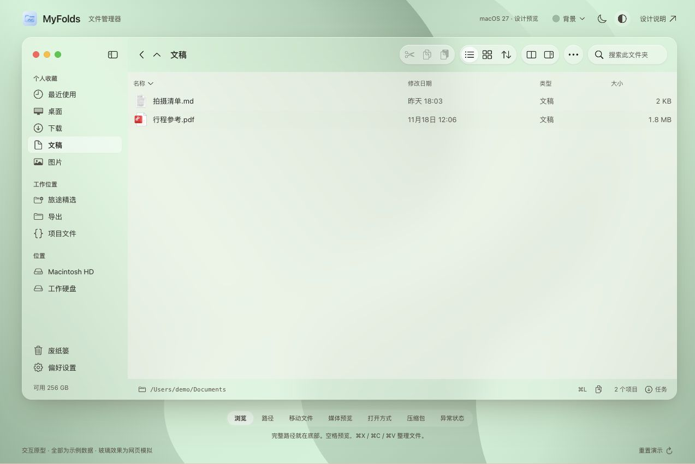

本版依据实际浏览的 [Apple macOS 官方宣传页](https://www.apple.com/os/macos/)重新组织窗口。页面当前展示 macOS 27；Mail 的操作组和 Safari 的工具栏是视觉关系参考，宣传图尺寸不直接当作应用规格。

日常浏览采用两栏：左侧位置导航，右侧文件列表，默认没有预览检查器。顶部压缩为一条统一工具栏；完整路径常驻底栏，可以复制、点击编辑和直接跳转。打开多个真实标签后才出现标签行。用户开启预览时增加第三栏，取消选择后保留面板并显示紧凑目录信息。

展示背景默认采用 36 秒一轮的 RGB 色彩流动，保留壁纸的几何曲面与明暗关系。窗口外右上角的“背景”可暂停、选择红绿蓝预设或手动调节 R/G/B，也可切回暖色壁纸。它服务于材质评审，不属于应用内常驻工具栏。

侧栏延伸到窗口边缘；剪切/复制/粘贴、视图和布局各自构成玻璃功能组。中间文件区与活动标签使用 32% 不透明度的雾灰填充和背景模糊，让桌面色彩及柔和明暗明显透入。照片、文件名与 SF Symbols 不使用前景滤镜。表头不再叠加独立底色，始终与文件区共享同一层磨砂。文件行滚到表头边界时被遮住，列名保持清楚，表头不会突然变厚。

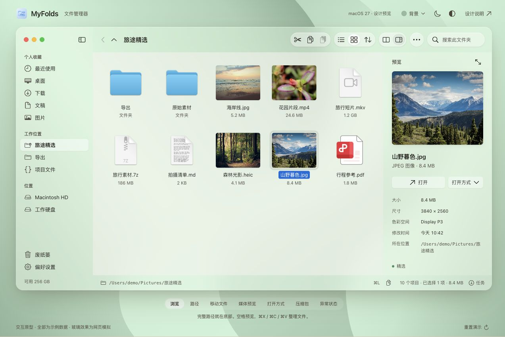

不增加常驻仪表盘、首页推荐和大面积品牌装饰。打开 MyFolds 就进入上次的目录；初次使用进入个人文件夹。真实产品中的系统红黄绿按钮、菜单栏、窗口行为和焦点样式交给 macOS。

| 视觉层 | 设计处理 | 目的 |
|---|---|---|
| 桌面与窗口底层 | 可切换 RGB / 暖色壁纸、共享透明磨砂、单层投影 | 保留 macOS 窗口与桌面的空间关系 |
| 导航与工具层 | 通高磨砂侧栏、按功能分组的玻璃控件 | 让位置与操作成为可辨认的功能层 |
| 文件内容层 | 浅色暖雾灰、深色炭灰；32% 填充与 28 px 背景模糊 | 长时间阅读文件名，准确查看图片 |
| 媒体层 | 深色观影背景；控制条悬浮在边缘 | 将注意力放在图片与视频上 |
| 任务反馈 | 底部短暂出现的操作条和进度条 | 持续看见来源、目标、进度与结果 |

## RGB 背景预览

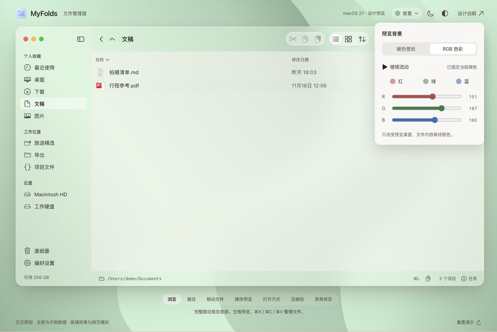

红、绿、蓝预设方便比较同一窗口的材质变化。手动调整或点击预设会暂停循环；继续流动从当前颜色衔接。系统减少动态效果时自动保持静止，并允许手动选色。颜色控制位于应用窗口之外，不占用文件操作空间。

## 主窗口与布局

| 区域 | 当前 UI 规格 | 交互职责 |
|---|---|---|
| 统一工具栏 | 高 64 px；当前位置标题；35 px 玻璃操作组 | 后退、上一级、剪切、复制、粘贴、视图、排序、布局、更多与搜索 |
| 侧栏 | 宽 194 px，紧凑时 174 px；条目高 30 px | 收藏、工作位置、磁盘、设置与废纸篓；透明轨道滚动 |
| 路径与状态底栏 | 高 38 px，输入区高 28 px | 完整路径、编辑、复制与跳转；项目数、选中数量及任务入口 |
| 标签栏 | 多标签才显示，高 34 px | 新建、切换、关闭；当前标签始终与目录对应 |
| 文件区 | 图标缩略图约 112 × 88 px；列表行高 32 px，表头与行背景左右贴齐 | 默认列表；名称优先，多选、排序、搜索、右键操作 |
| 检查器 | 宽 274 px，紧凑时 230–250 px；默认关闭 | 用户开启后显示预览、打开方式与元信息；无选择时提供目录信息 |

建议原生窗口最小 960 × 640 pt，推荐 1200 × 760 pt 及以上。HTML 的像素尺寸用于审阅，不是已验证的 AppKit 约束。窄浏览器布局只用于查看设计，不代表计划开发移动版。

窗口变窄时搜索收成可展开图标，优先收起日期等辅助列。侧栏在窄浏览器中通过右上方按钮展开覆盖层；预览也作为覆盖层显示。文件名称不能为了保留辅助列而持续缩小。双栏模式收起右侧检查器，让两个目录拥有足够宽度。

原型中的标签已分别保留目录、历史、选择、滚动、视图、查询与预览状态。通过更多菜单或 ⌘T 新建标签，标签上的关闭按钮或 ⌘W 关闭当前标签；剩一个标签时收起标签栏。重启后的会话恢复仍留待原生实现。

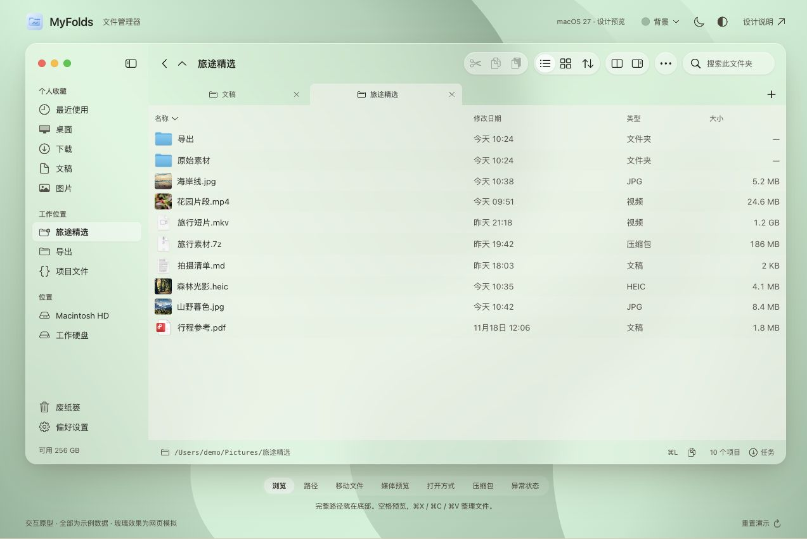

## 复制、剪切、粘贴

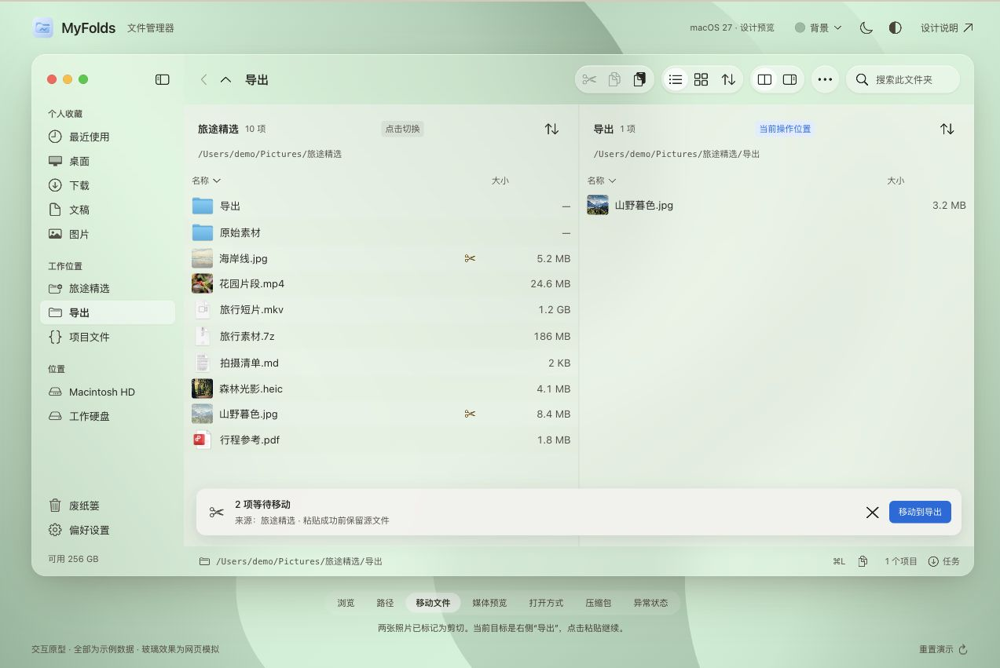

工具栏明确提供剪刀、复制和粘贴图标，悬停显示名称与快捷键；右键菜单提供同样操作。⌘X、⌘C、⌘V 是默认快捷键，避免用户记忆特殊组合。

剪切之后，源文件保留，图标变淡并出现剪切标记，底部显示“2 项等待移动”和来源。进入目标目录后，按钮直接写“移动到导出”，用户可以核对后继续。按取消只取消待移动意图。操作条浮在文件区底部，不推挤网格；列表保留末尾滚动空间，避免最后一行被遮挡。复制与剪切使用同一个反馈位置，不再同时弹出重复成功提示。

双栏中的当前操作位置通过“当前操作位置”文字和轻量选中底色标识。点击另一栏后，地址栏和粘贴目标随之更新；两栏各自保留可读路径。目标位置相同、只读、无权限或位于被移动文件夹内部时应禁用操作并说明原因。

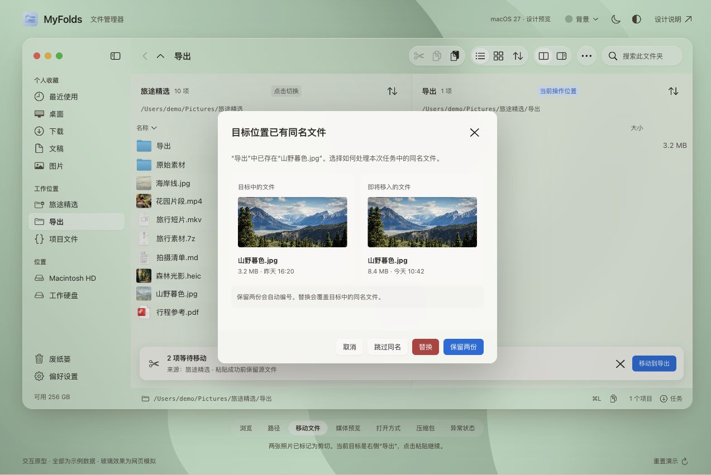

同名冲突显示两份文件的缩略图、大小和修改时间，提供“跳过同名、保留两份、替换、取消”。保留两份为推荐操作，替换使用危险按钮。产品应逐项处理冲突，只有用户勾选后才将策略应用到剩余项目。原型简化为处理本次示例任务的全部同名项，并在弹窗中写明作用范围。

同盘移动优先使用系统移动语义；跨盘移动先复制并确认成功，再删除对应源文件。任务取消、磁盘断开或空间不足时，显示已完成与未完成的项目。撤销只在可恢复条件成立时提供。原型通过内存快照演示，不能视作真实跨盘恢复能力。

## 常驻、可编辑的路径

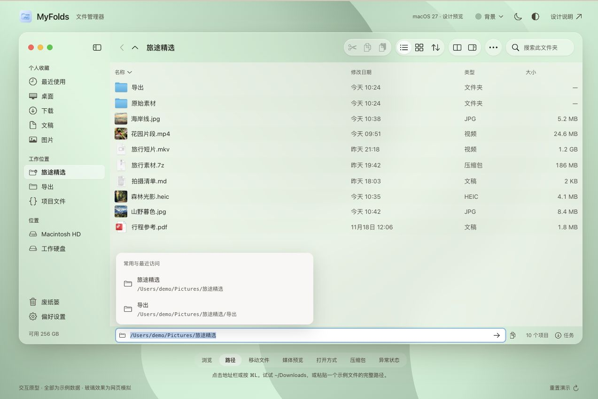

完整路径始终可见，右侧一键复制。点击路径或按 ⌘L，全选并进入编辑；输入后 Return 前往，Escape 取消编辑并把焦点交回路径按钮。静止时只显示路径文字，编辑时才出现浅色输入底和系统蓝焦点环。提供最近访问和目录补全，支持中文、空格、绝对路径和 ~ 用户目录。

粘贴文件路径时进入父目录并选中该文件；粘贴目录路径时直接进入。复制选中文件的路径使用 ⌥⌘C。路径过长时显示截断，但悬停和编辑状态提供全文，复制永远使用完整值；路径方向始终从左到右。

修改地址只用于导航。重命名通过独立流程完成，不能把修改路径误解为移动或重命名文件。路径输入不执行 shell 命令。不存在、无权限和磁盘离线分别提供明确提示，保留输入供修正。

## 图片与视频预览

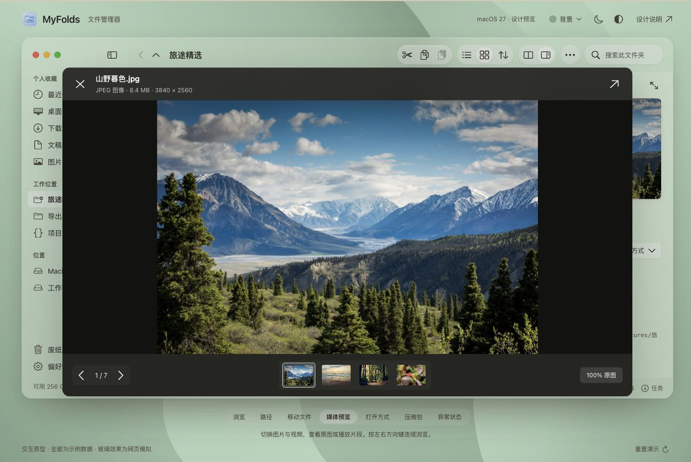

单击文件即在检查器显示预览。Space 打开快速预览；Escape 返回，并保留原来的目录、滚动和选择；焦点恢复到触发预览的文件或按钮。键盘焦点不在播放控件或其他按钮时，Space 也可关闭预览；控件上的 Space 优先执行控件本身的操作。放大视图保留文件名、序号、前后切换、底部缩略条及外部应用入口。

图片优先提供适合窗口、100% 比例与连续浏览；原生版再实现平移、缩放级别、旋转和色彩管理。当前原型的 100% 对应本地示例图的实际像素，展示元信息是合成样例。

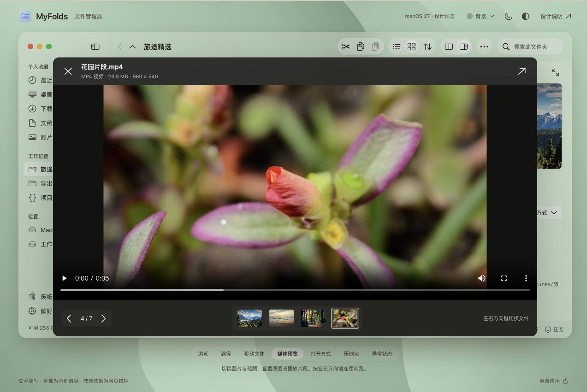

视频提供播放暂停、进度拖动、音量、时长及编码信息。切换文件时停止旧播放、取消旧预览请求。缩略图和元信息异步加载，不能阻塞目录操作。

未支持的内容显示“暂时无法预览此文件”，提供“选择打开应用”。文件仍可复制和移动。实际视频能力按封装、视频编码、音频编码、HDR 和字幕分别验证，不能只依据 .mp4 或 .mkv 扩展名承诺兼容。

原型真正播放的是本地 MP4 示例；HEIC 文件名下使用 JPEG 示例图，压缩内容和文件元信息为演示数据。RAW、HEVC、MKV、HDR 等列入后续样本验证，不属于当前已实现能力。

## 打开方式

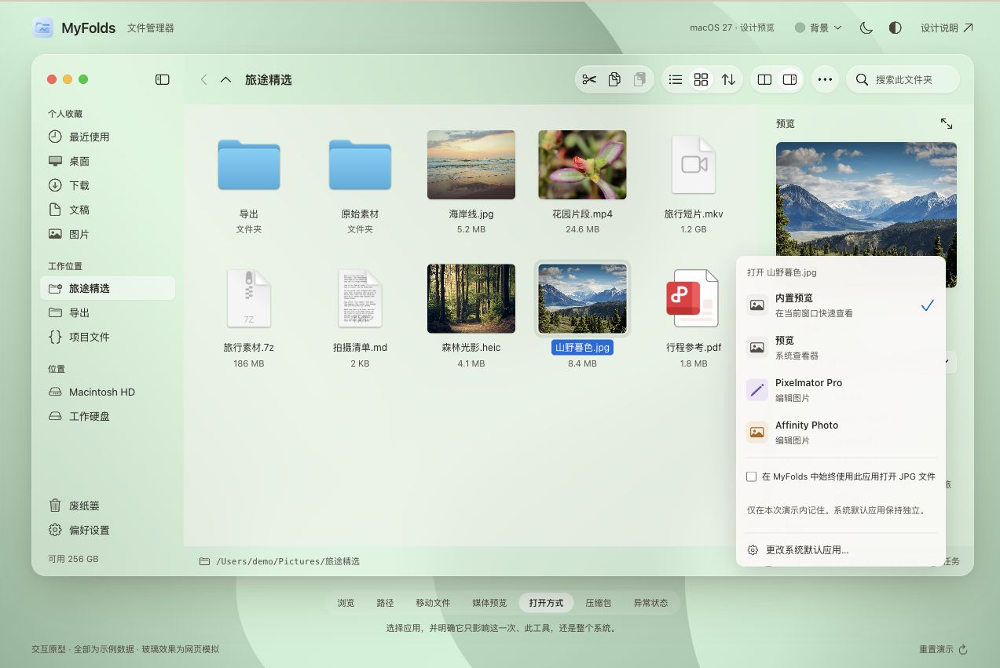

检查器和右键菜单提供“打开方式”。显示内置预览、系统建议和适合当前文件类型的应用：图片编辑器、视频播放器、文本编辑器、PDF 阅读器分别匹配内容。原生应用只显示实际可用的应用，并提供“选择其他应用”。

| 选择范围 | 用户操作 | 行为 |
|---|---|---|
| 仅本次 | 点击应用 | 只打开当前文件，不记录类型规则 |
| MyFolds 内默认 | 勾选“在 MyFolds 中始终使用…” | 后续从 MyFolds 双击同类型文件使用这个应用 |
| 系统默认 | 明确进入“更改系统默认应用…” | 展示影响范围，采用系统支持的文件关联流程 |

双击和“打开”遵循 MyFolds 类型规则，未指定时采用系统关联；Space 始终保留快速预览语义。设置页集中查看和清除规则。

原型保存当前演示会话的偏好，应用启动由提示代替；系统默认入口展示 Finder“显示简介 → 打开方式 → 全部更改”的说明，不修改系统。展示的应用名单是样例，不代表已检测到安装。

## 压缩包像文件夹一样浏览

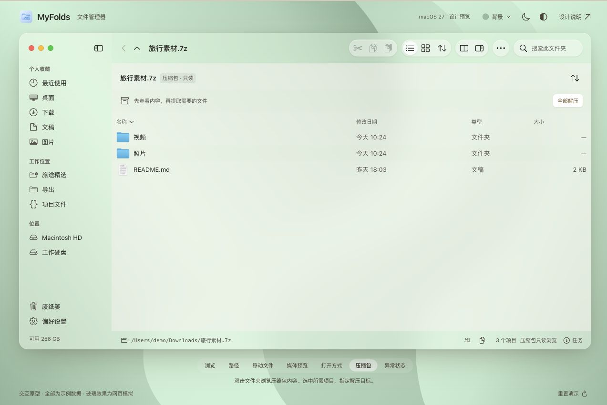

打开压缩包进入虚拟目录，标题与路径附近明确显示“压缩包 · 只读”。支持查看子目录和选择条目，再使用“解压所选”；无选择时显示“全部解压”。确认区显示目标路径和同名处理策略。

包内复制等价于提取到普通目录；剪切、重命名和删除不开放。第一版不直接编辑原包。提取任务提供进度、取消、错误定位与结果入口。

| 能力 | 第一版建议 | 范围说明 |
|---|---|---|
| 浏览与解压 | ZIP、7z、RAR、TAR，以及 gzip / bzip2 / xz 常用变体 | 格式版本、文件名编码、符号链接需分别验证 |
| 创建 | ZIP | 后续再评估 7z 创建和参数面板 |
| 加密包 | 依引擎能力逐格式实现密码输入 | 不将“支持 ZIP”直接等同于支持全部加密算法 |
| 分卷 | 识别缺失分卷并提示 | 单独验证 RAR / 7z 分卷组合 |
| RAR 创建 | 暂不列入第一版 | 读取与创建是不同能力 |

提取必须限制在目标范围内，拒绝路径穿越，避免通过符号链接写出目标目录；覆盖冲突、剩余空间、扩展属性与资源分支分别处理。这是工程验收要求，原型只演示虚拟 7z 目录与选择性提取。

## 偏好设置

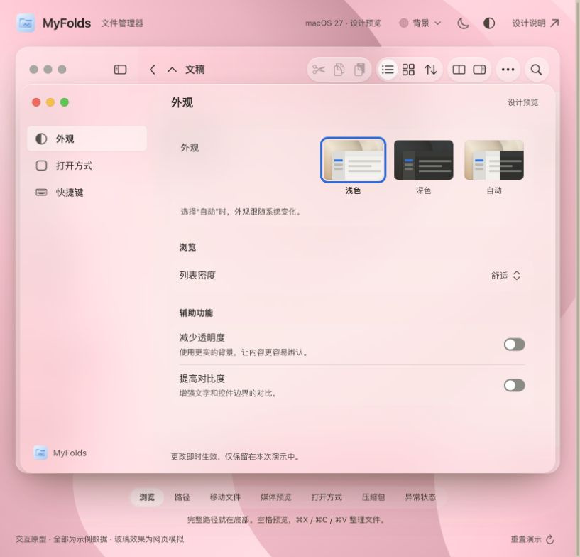

偏好设置参考实际查看的 macOS“系统设置”，使用独立窗口、左侧分类和右侧分组表单。窗口不会调暗文件窗口，设置即时生效，不需要点击“完成”。三类内容分别是外观、打开方式和快捷键，不放入无关的系统账户或网络分类。

| 部分 | 界面与交互 |
|---|---|
| 窗口 | 桌面预览为 760 × 552 px，190 px 侧栏、52 px 标题栏；关闭后记住当前分类与本次演示的设置 |
| 外观 | 浅色、深色、自动三张可选缩略图；自动跟随系统；列表密度右对齐弹出选择器 |
| 辅助功能 | 30 × 18 px 紧凑开关；名称与解释上下排列；减少透明度、提高对比度即时应用 |
| 打开方式 | JPEG、HEIC 与 MPEG-4 各自选择默认应用，和文件的“打开方式”菜单共享状态 |
| 快捷键 | 按浏览、文件操作、预览与设置分组，右侧排列系统修饰键；长内容在窗内滚动 |
| 键盘 | ⌘, 打开；Escape 或 ⌘W 关闭并恢复入口焦点；方向键切换分类，设置按键不会传给背后的文件列表 |

设置与主窗口共用玻璃语言：18 px 圆角、32 px / 1.25 背景模糊、窗口投影与细亮边；分类采用中性透色选中态和单色 SF Symbols。设置覆盖在已经磨砂的主窗口上，因此侧栏、正文和分组只增加薄层填充，避免叠成实体白色表单。浅色填充分别为 rgba(255,252,245,.06)、rgba(241,240,237,.14)、rgba(255,255,255,.06)；深色对应 12%、20% 炭灰和 2.5% 白色。背景的大块色彩和明暗经过模糊后仍可见，文字与控件保持清晰。分组主要靠留白，组内保留缩进细分隔；减少透明度时恢复实体材质。上述数值适用于本原型的叠层关系，不替代 AppKit 系统材质。

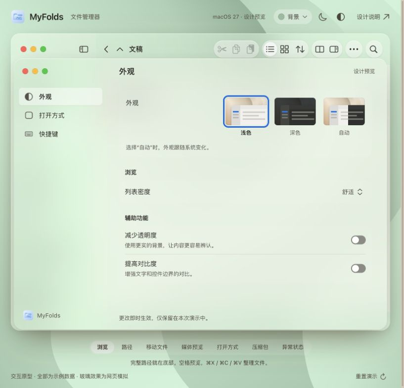

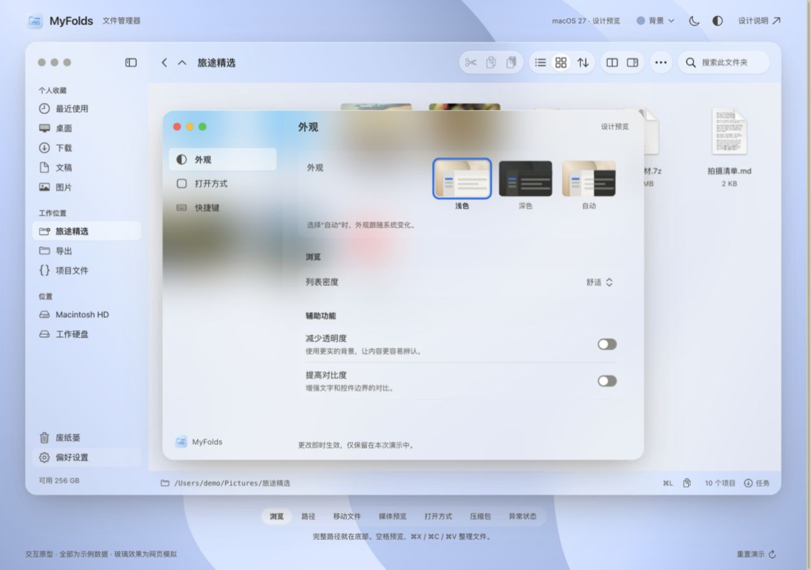

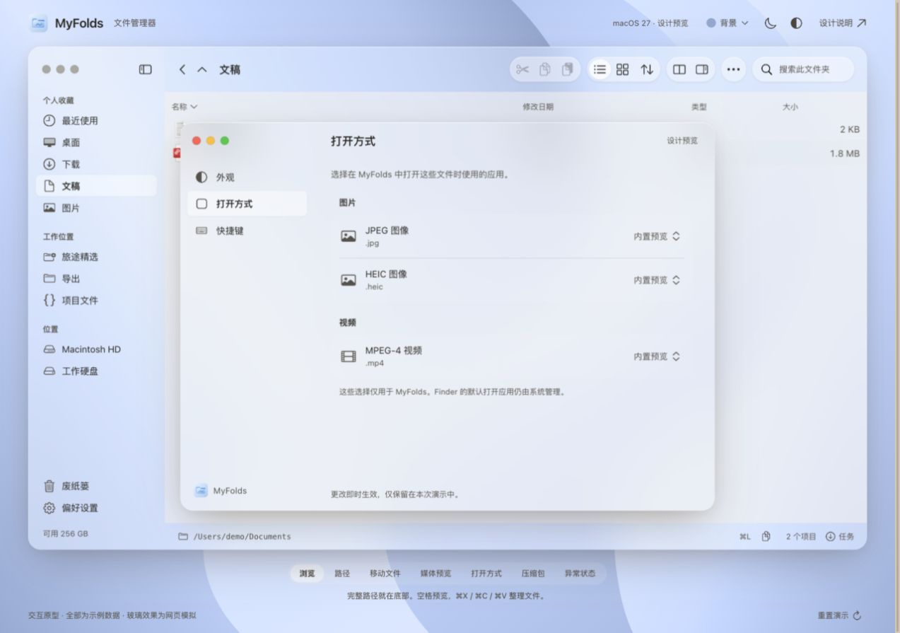

选择只作用于 MyFolds，本原型仅保留在当前页面内存中；不启动外部应用、不更改 Finder 的系统关联。原生版应使用系统窗口、表单与选择控件，并在实现阶段决定持久化方式。窄浏览器会把设置分类移到顶部，保持可操作性；这不是移动版产品设计。

## 深色与辅助功能

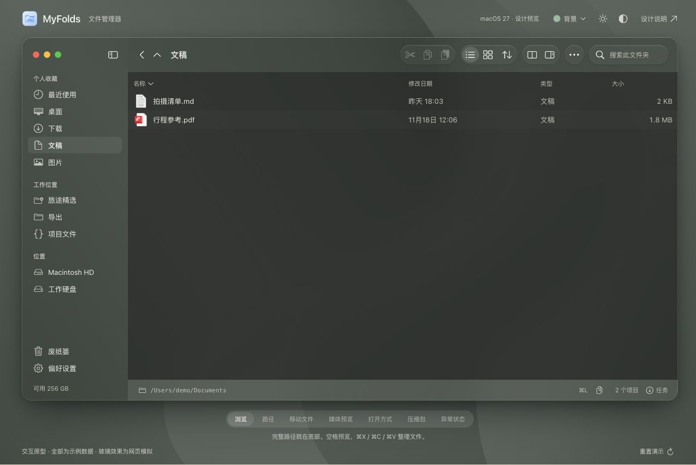

深色使用中性炭灰文件区，玻璃层感知背景但不染色照片，正文保持清晰。偏好设置提供浅色、深色与自动三种外观；自动模式会响应系统外观变化。预览页右上角也可以直接切换浅深色。

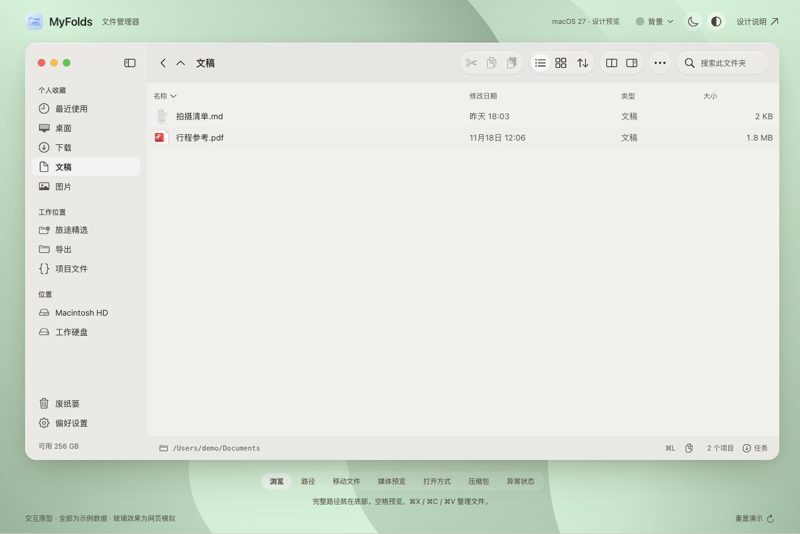

减少透明度时，内容区、表头、活动标签、侧栏、检查器、工具栏和弹层使用稳定实体底色，布局与操作位置不变。提高对比度时增强次要文字、控件边界和选中状态；减少动态效果时暂停 RGB 循环，仍可手动选色，并关闭装饰性过渡。

使用系统字体与 SF Symbols。每个纯图标按钮有可读名称和悬停提示，选中状态同时提供名称、焦点与数量反馈。图标视图只给文件名着选择色，列表视图使用左右顶格、端部无圆角的连续选中行；窗口失焦后选择转为中性灰。危险操作不只用红色表示，剪切也不只依赖透明度。原生阶段需要完整验证 VoiceOver、键盘导航、系统偏好切换和高分辨率显示。

## 设计参数

本轮按用户反馈进一步提高内容区透明度：由 72% 填充不透明度降低到 32%。背景颜色经过磨砂进入文件区，背景模糊 28 px；图片与文字不被模糊。表头背景透明，复用文件区的 32% 填充和背景模糊，不再重复叠色。滚动文件行只显示在表头下方。不添加颗粒、额外边线或装饰渐变。

| 参数 | 浅色基准 | 设计规则 |
|---|---|---|
| 文件内容 | rgba(241,240,237,.32)；深色 rgba(35,35,32,.32) | 内容与活动标签共享材质；减少透明度时恢复 #F1F0ED / #232320 |
| 列表表头 | 透明，复用文件区磨砂底；无独立背景模糊 | 整段 thead 吸顶；文件行在表头下方裁切，避免文字或选中底色重叠 |
| 主要文字 | #272521 | 文件名和当前位置优先 |
| 次要文字 | #555049 | 元信息、说明和组标题 |
| 系统感强调色 | 蓝色；文字按钮基准 #006CDD | 主要操作、选择和键盘焦点，不作为大面积装饰 |
| 磨砂材质 | 窗口 rgba(255,252,245,.32)，网页模糊 32 px；检查器轻覆 25% | 网页仅近似；原生使用系统语义材质 |
| 字体 | 系统 UI 字体；路径用 SF Mono / Menlo | 不引入营销展示字体 |
| 文字大小 | 列表文件名 13；图标文件名 12；正文 12–13；标题 15；辅助信息 11 px | 生产版依系统字级与实际密度调整 |
| 圆角 | 原型窗口 18；玻璃组 22；搜索框 20；菜单 10；对话框 13 px | 系统窗口与控件以系统形状为准 |
| 动效 | 控件反馈约 120 ms；预览桌面 RGB 循环 36 秒 | 页面隐藏时暂停；减少动态效果时静止，可手动选色；文件列表不移动 |

打开方式、路径建议与对话框承载密集文字，使用 97% 中性底色保住可读性，避免后方文件信息透字；主窗口仍使用通透磨砂层。

原生系统的动态颜色、材质和圆角优先于这些网页取样值；原型颜色不应硬编码成 macOS 27 的系统色。

## 控件与微交互

| 细节 | 当前设计 |
|---|---|
| 工具按钮 | 关联操作共享玻璃组，内部按钮悬停与按下有中性底；导航按钮保持轻量；禁用降低可见度并保留名称提示 |
| 视觉分组 | 同组间隔 1 px、容器内边距 3 px，组间约 9 px；紧凑时组间 6–7 px，减少竖向分隔线 |
| 路径与搜索 | 路径常驻、编辑才显出输入框；搜索获得焦点后显示焦点环，窄窗展开输入 |
| 标签页 | 当前标签与文件内容底色连成一体，无独立投影；非当前标签保持透明 |
| 文件选择 | 点击空白取消；⌘点击多选；Shift 点击连续选择；右键已选文件保留多选 |
| 键盘导航 | 网格左右移动一项、上下按列数移动；文件区保留一个 Tab 入口，再用方向键导航 |
| Escape | 优先退出最上层菜单或对话框，其次退出路径编辑；关闭后恢复合理焦点 |
| 控件快捷键 | 按钮上的 Return / Space 先激活按钮，避免被全局文件预览或重命名拦截 |
| 滚动位置 | 同一目录选择文件、刷新任务反馈、退出快速预览时保持滚动位置 |
| 颜色 | 工具与导航使用中性灰；应用强调色用于选择、焦点及明确主操作；预览桌面可独立采用 RGB 色彩 |
| 列表边缘 | 列表容器左右留白为 0；表头、隔行底色与选中行贴齐文件区。文字/图标保留桌面 10 px 单元格内间距，窄窗为左 6 / 右 5 px |
| 信息边界 | 检查器、状态栏和元信息之间去掉装饰分隔线；目录和任务分区只保留必要结构 |

这些规则用于约束后续原生实现。网页中的窗口失焦、焦点环和交互是演示，最终应交给 macOS 的窗口与响应链处理。

## macOS 27 的原生实现

建议使用 SwiftUI 管理界面状态，结合 AppKit 处理文件列表、窗口、菜单、拖放和复杂桌面交互。具体控件选择通过大目录与文件操作验证后确定。

| UI 区域 | 原生映射建议 | Liquid Glass 处理 |
|---|---|---|
| 窗口与导航 | 系统窗口、NavigationSplitView 或 NSSplitViewController | 使用系统提供的浮动侧栏与标题栏行为 |
| 工具栏 | Toolbar / NSToolbar；按任务分组 | 优先使用当前 SDK 的标准控件外观 |
| 检查器 | SwiftUI inspector 或 AppKit 检查器区域 | 使用系统检查器材质，内容维持可读性 |
| 自定义悬浮操作条 | 小范围自定义视图 | 需要时使用 glassEffect 与 GlassEffectContainer |
| 文件列表与图标区 | Table / NSTableView、NSCollectionView 等候选 | 保持稳定内容底色，不给每一项套玻璃 |
| 图片、视频与文件缩略图 | Quick Look、ImageIO、AVKit / AVFoundation 等候选 | 预览内容保持保真，控制层使用系统材质 |

Apple 的 Liquid Glass API 自 macOS 26 已提供；MyFolds 面向 macOS 27 使用对应 SDK 和运行时的原生表现，不虚构“27 专属玻璃 API”。使用新 SDK 本身不代表所有自定义视图都会自动获得合适的玻璃效果，必须逐个确认控件归属和可读性。

文字较多的导航和菜单以 regular 材质为先；clear 仅在媒体等适合场景中考虑。优先让系统完成对比度、光线、窗口激活和辅助功能适配，避免把网页 blur 参数直接搬入原生产品。

如果后续决定兼容 macOS 26 之前的系统，需要单独规划材质退化和 API 可用性分支。目前最低系统版本仍待确认；macOS 27 是本轮明确目标。

依据：[Apple HIG · Materials](https://developer.apple.com/design/human-interface-guidelines/materials)、[Adopting Liquid Glass](https://developer.apple.com/documentation/technologyoverviews/adopting-liquid-glass)、[Build an AppKit app with the new design](https://developer.apple.com/videos/play/wwdc2025/310/)、[glassEffect](https://developer.apple.com/documentation/swiftui/view/glasseffect%28_%3Ain%3A%29)、[GlassEffectContainer](https://developer.apple.com/documentation/swiftui/glasseffectcontainer)。

## 错误、恢复与快捷键

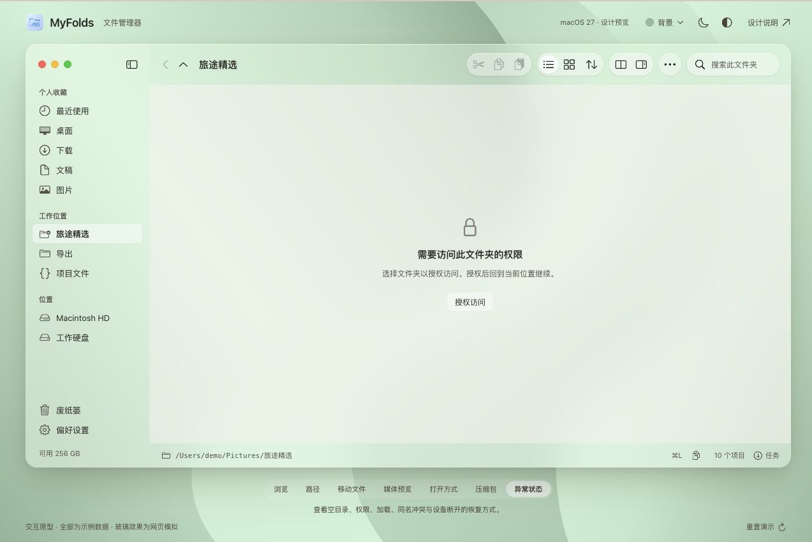

| 状态 | 提示与恢复 |
|---|---|
| 空目录 | 保留路径，提供新建或粘贴 |
| 搜索无结果 | 保留关键词，提供清除搜索 |
| 正在读取 | 渐进显示已加载内容，可取消 |
| 无访问权限 | 说明需要授权，提供选择文件夹入口 |
| 磁盘断开 | 保留任务结果与未完成项，重连后只重试需要的部分 |
| 空间不足、只读、文件占用 | 显示受影响项目及目标，提供换位置或重试 |
| 预览失败 | 不影响文件管理，提供外部应用入口 |

| 操作 | 快捷键 |
|---|---|
| 剪切 / 复制 / 粘贴 | ⌘X / ⌘C / ⌘V |
| 编辑路径 / 搜索当前目录 | ⌘L / ⌘F |
| 复制文件路径 | ⌥⌘C |
| 快速预览 / 关闭 | Space / Escape |
| 新建 / 关闭标签 | ⌘T / ⌘W |
| 打开 / 上一级 | ⌘↓ / ⌘↑ |
| 重命名 / 新建文件夹 | Return / ⇧⌘N |
| 多选 / 全选 | ⌘点击、Shift 点击 / ⌘A |
| 文件导航 | 方向键；网格上下按当前列数移动 |
| 移到废纸篓 / 撤销 | ⌘Delete / ⌘Z |

浏览器可能保留部分快捷键，因此原型同时提供按钮入口。生产版完整的焦点顺序、菜单快捷键和跨应用拖放需使用原生事件验证。

## 实现顺序与交付边界

第一阶段完成原生窗口、目录浏览、常驻路径、剪切复制粘贴、冲突与任务反馈；第二阶段接入图片视频预览、打开方式；第三阶段接入压缩服务、格式矩阵与异常恢复。第一版发布必须覆盖全部五项核心需求。

验收至少覆盖：中文与长路径；含约一万项的目录；文件路径定位；同名冲突；跨磁盘移动中断；快速切换媒体；默认应用作用域；压缩包选择性提取；浅深色、减少透明度和键盘导航。目录规模是验证用例，不是已经达到的性能指标。

当前原型可演示上述核心交互、列表与图标切换、双栏、设置和边界状态。示例数据驻留内存，切换场景会重置文件与任务；真实文件系统、压缩解析、外部应用启动、系统关联、持久权限与系统 Liquid Glass 尚未实现。

进入产品开发前还需确定：个人使用或公开分发、最低 macOS 版本、实际常用媒体和压缩格式、是否覆盖网络盘与云端占位文件。名称已确定为 MyFolds。

素材来源见 assets/sources.json 与 assets/README.md。系统图标和 SF Symbols 用于 macOS 平台设计参考；照片及视频是公开示例，不是用户文件。
