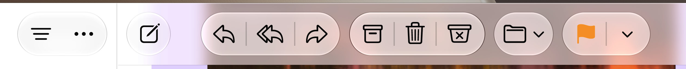

# MyFolds：依据 Apple 官方实图重新校准设计

2026-11-20。此次是对 v0.3 的设计方向纠正。v0.4 已按以下结构重制原型；实图见主设计包。

用户提供的实际截图是本次判断依据，优先于先前自动化截图和“ship”结论。交互检查通过不能证明界面具有 Apple 原生质感。

## 参考来源

本次实际浏览了 [Apple macOS 官方宣传页](https://www.apple.com/os/macos/)。页面当前展示 macOS 27 Golden Gate。查看了 Mail 的 Liquid Glass 工具栏、Safari 工具栏与标签，以及 Design refinements 的材质细节。Apple 的说明强调统一工具栏、延伸到边缘的侧栏、折射与对比度的一致性。中国大陆当前 macOS 路径跳转到 OS 概览，因此以实际打开的英文 macOS 页面为主；未把搜索缓存中的 Tahoe 页面当成当前 27 的证据。

配图来自 Apple 官方页面，仅用作设计对照，不属于 MyFolds 的原创设计；来源 URL 记录在 sources.json。宣传图是局部放大图，不能把图中像素直接换算成应用控件的 pt 规格。

## 当前版本的具体问题

| 当前截图 | 官方参考带来的判断 | MyFolds 的修正方向 |
|---|---|---|
| 暖灰壁纸、灰色窗口和灰色侧栏相近，整体厚且闷 | 玻璃需要借助环境的明暗与色彩变化显出层次；背景色可透入，文字与符号仍清楚 | 保留非蓝背景要求，用柔和暖金、米白或少量桃色光线提供透色差异，避免整屏同一种灰 |
| 工具图标大量裸露、弱灰，只有部分按钮有底 | 官方有明确的功能按钮组、透明实体感、细亮边、内部明暗与圆润轮廓 | 按操作分组恢复少量玻璃控件；不为每个按钮单独套胶囊，也不全部去掉底色 |
| 标题工具栏、路径栏、标签栏三层常驻 | 原生层级随任务组织，控件与内容的关系紧凑 | 重排窗口骨架；单标签时不占独立标签行，路径常驻但收成轻薄的一行 |
| 文件区像贴在厚灰底上的白色大板 | 稳定内容底色是合理的，关键是与窗口分栏和工具区的边缘关系 | 内容区与分栏统一对齐，减少额外嵌套；不把文件列表也做成透字玻璃 |
| 无选中项时，右侧仍被大块“选择文件以预览”占住 | 预览空间应对用户当前任务有价值 | 日常列表默认两栏；预览由用户开启，开启后用紧凑的目录/选择信息替代大号占位 |
| 侧栏有明显白色滚动轨道、组间距偏散 | 实际浏览器外观暴露了验证不足，不能只看默认示例截图 | 明确测试当前应用浏览器中的滚动条、短窗口和真实导航状态；保留可滚动性，避免白色轨道切断材质 |
| 标题是“文稿”，标签仍固定显示其他目录 | 功能状态与视觉导航不一致，削弱可信度 | 标签随实际目录更新；目录标签与侧栏收藏必须区分 |

## v0.4 的窗口结构

日常浏览以两栏为基础：左侧原生密度的位置导航，右侧完整文件区。顶部是一条统一工具栏，左侧当前位置与导航，右侧按文件操作、视图、搜索形成少量功能组。完整路径仍常驻、可复制、可编辑，使用紧凑路径行；只有真正打开多个标签时才显示标签行。

用户打开预览后显示第三栏。已有预览面板不因简单取消选择而反复跳动；空选择使用紧凑目录信息。图片与视频继续支持快速预览，避免为了展示一张图片而让所有目录都默认携带空面板。

保留已确认的五项需求，不增加仪表盘、推荐信息和营销装饰。设计演示背景服务于展示玻璃；应用本身采用系统语义材质，不固定染成背景的某个颜色。

## 修正验收方式

以用户当前浏览器中的实际页面为主要验收环境，同时覆盖宽窄窗口。至少对照：文稿目录仅两项且无选中、图片目录选中与未选中、列表/图标、开启/关闭预览、单/多标签、深浅色、系统滚动条偏好、减少透明度。每个状态都检查窗口比例、材质层次、操作可辨识性和导航一致性。

HTML 可以展示结构和近似材质，但不等同于系统 Liquid Glass 的折射与动态渲染；生产实现应交给 SwiftUI/AppKit 的系统组件。本版判断基于上述原生实图和用户状态，不再用“检查通过”代替美观结论。

v0.4 采用 64 px 单工具栏、194 px 通高侧栏、38 px 路径/状态底栏；默认列表且预览关闭，多标签时才出现 34 px 标签行。桌面 1280 × 850、紧凑 1080 × 720，以及当前 537 px 浏览器均进行了实测。
